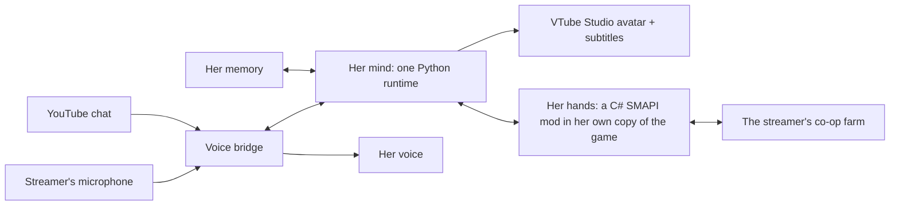

# ARTI — an AI VTuber who lives on stream

*An Indonesian AI VTuber who talks with her streamer and chat, remembers, and is learning to play games by herself.*

ARTI is not a chatbot glued to an avatar. She hears the streamer, reads YouTube chat, answers in her own voice through her own VTube Studio avatar, and remembers what happened in earlier streams. Her big ongoing challenge is playing a real game with her own hands, by her own choices. Right now that game is Stardew Valley: she joins her streamer's farm as a co-op farmhand and lives her own days there.

**Watch her:** https://www.youtube.com/@bohanyt

## What works today

| Part | Status |
| --- | --- |
| Talking live in Indonesian (microphone in, her own voice out) | Works on real streams |
| Reading and answering YouTube chat | Works on real streams |
| Her avatar in VTube Studio (expressions, reactions, subtitles) | Works on real streams |
| Remembering earlier streams and what she did | Works; still growing |
| Playing Stardew Valley by herself as a co-op farmhand | Experimental: she plays real sessions, but she is slow (about a minute per decision) and still gets stuck |
| Minecraft player (Mineflayer bridge in `mc-bot/`) | Older integration, not the current focus |

"Works on real streams" means it has run on her channel. A change that only passed its tests is not counted as proven.

## How she works

- **Her mind** builds a "page" each moment: what she sees, what she remembers, and the choices open to her. A language model picks one, the runtime carries it out through the mod, then checks the effect in the world.
- **Her hands** (`stardew-mod/`) run inside her copy of the game. They report what is around her, press what she chose, and read the result back from game state instead of assuming a command worked.
- **She learns the game as facts, never as orders.** Seasons, crops, money, shops and the Community Center reach her as things that are true. What to do about them stays her decision.
- **The ARTI who answers chat is the same ARTI who plays.** She reacts to her own journey instead of narrating it.

`docs/WIRING.md` shows how the parts connect.

## Status

Experimental. This is one person's project and a working lab, not a product. It runs on its author's own machines and is pushed forward with AI coding agents. Nothing is packaged to install and run: it is published so the work can be seen, read and judged.

## What is not in this repository

- **Recorded sessions.** Recordings, transcripts and logs of real streams carry viewers' names and voices. They
  are not the author's to publish.
- **Game assets and game text.** Saves, screenshots, image crops and test fixtures that contain the game's own
  text belong to the game's owner. You need your own copy of Stardew Valley.
- **Private memory.** Her persona file, her memory, and the viewer and mood files are personal to the channel and
  to the people in it. The `*.example.*` files show the shape of what is missing.
- **Keys and tokens.** Bring your own.
- **Game-derived tables and ports.** Larger tables read from the game's content files (crop data, festival
  dates, bundle rows) and offline ports of game routines are left out, so some of the public code is incomplete:
  the crop table module ships as a stub without data. Short game identifiers (item ids, place and character
  names, menu class names), a few re-implemented game rules and some short on-screen strings the code matches
  are still in the code.
- **The C# test projects.** They need the game's assemblies and inputs that are not here; the public C# is the
  mod itself.
- **The working notes.** Design records, run reports, one-off analysis scripts and the coordinator's notes quote
  sessions and the game, so this first release leaves them out.

`docs/WHAT_IS_NOT_IN_THIS_REPO.md` has the longer list. Because of this, code and tests sometimes name a file
that is not here. Tests that replayed recorded sessions or game captures are left out. The Python tests that
ship use inputs made for them; some began as the shape of a real game state or a real session, with the game's
text and recorded speech replaced by invented text (`docs/TESTING.md`).

## Setup

Set-up is by hand and is not automated. `docs/SETUP.md` is a short map of it. In short you need:

- Stardew Valley with SMAPI, in two instances (the host and her farmhand);
- the .NET SDK, to build the mod;
- Python environments for the runtime, the tests and the voice bridge (`requirements*.txt`);
- VTube Studio, for the path with voice and avatar;
- a language-model provider, with your own account or key.

Copy the `*.example.*` files to their real names and fill in your own values. That gives a plain ARTI: the
example persona and an empty memory. No save ships: start a new co-op farm in your own game for her to join.

## Licence

MIT, see `LICENSE`. The licence covers the original ARTI material in this repository. Stardew Valley, SMAPI,
VTube Studio, Minecraft, and the libraries and models this code talks to belong to their own owners and are not
included. This project is not affiliated with any of them. Third-party credits are in `NOTICE`.
