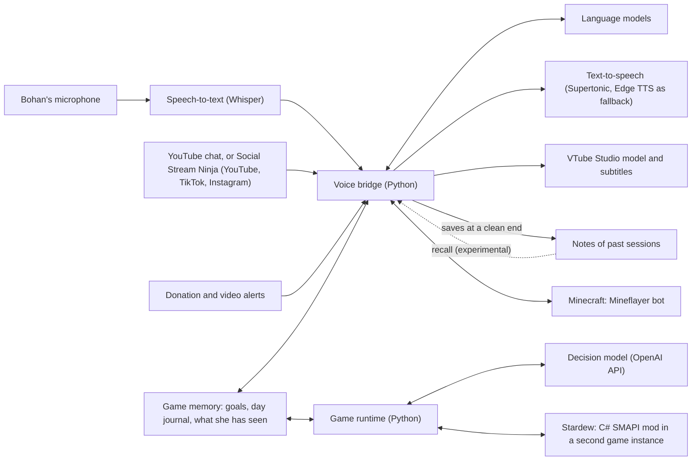

# ARTI: an Indonesian AI VTuber

ARTI is an Indonesian AI VTuber who co-hosts Bohan's livestreams. She talks with Bohan, answers viewers in YouTube chat, and is learning to play Stardew Valley as a second player on a co-op farm.

On stream, a Python voice bridge turns Bohan's speech into text and passes it to a language model along with live chat. It then speaks her reply in Indonesian through text-to-speech and drives a third-party VTube Studio model. In Stardew, a language model chooses her next action. The game runtime carries it out and checks what changed. ARTI is meant to play many games: she played Minecraft on stream before Stardew, and more games are meant to follow.

**Watch ARTI:** https://www.youtube.com/@bohanyt

- A 35-second clip: [Arti inisiatif🥹](https://www.youtube.com/shorts/qsH_IT3EOd0)
- A full Stardew stream: [arti main stardew valley hari 8 sampai... idk lol](https://www.youtube.com/watch?v=A4TFWrpWApQ)

## What she does today

| What | Status |
| --- | --- |
| Talks live in Indonesian: hears Bohan's microphone (speech-to-text) and answers out loud (text-to-speech) | Works on real streams |
| Reads and answers YouTube live chat | Works on real streams |
| Reads TikTok and Instagram chat as well, through Social Stream Ninja (one reader for YouTube, TikTok and Instagram) | In the code |
| Drives a VTube Studio model (expressions, idle motion, nods, quick reactions) and shows subtitles | Works on real streams |
| Thanks viewers for donations (the bridge supports Saweria, Trakteer and Streamlabs) | Works on real streams; on 2026-11-15 her thanks came 47 s and 150 s after two donations |
| Watches and talks about videos viewers send with a donation (a Google Gemini model watches the clip) | Works on real streams; slow: in one stream the first try timed out on two of three videos, and the fallback took up to 77 s |
| Thanks new YouTube subscribers (a Streamlabs alert) | In the code: such an alert was missed on 2026-11-17; the fix has no stream record yet |
| Saves notes when a session ends cleanly, and looks them up when she talks | Experimental: recalling the right notes is not reliable yet; in a rehearsal she mixed up notes from two farms, and some live session notes are saved where her recall does not look |
| Plays Stardew Valley by herself as a co-op farmhand | Experimental: she has played on a real stream and in long test sessions, but she is slow, gets stuck and makes little progress |
| Sets her own goals for the game and keeps a short journal of each game day | Experimental: her goals do not close yet |
| Plays Minecraft as a Mineflayer bot that carries out actions named in her replies | Experimental: played on streams in August 2026; not part of the current stream setup |
| Switches OBS scenes between a talk scene and a game scene | In the code: not part of the current stream setup |
| Looks at the screen and listens to desktop audio for context | In the code: not part of the current stream setup |

**Works on real streams**: it has run on her live streams.
**In the code**: built into the voice bridge, with no live stream record yet.
**Experimental**: she does it, on stream or in test sessions, but not reliably.

## How she works

- **Voice.** Speech-to-text is Whisper (`whisper-large-v3` and `whisper-large-v3-turbo`) through the Groq API. A local faster-whisper model takes over when Groq is not available. She answers through text-to-speech, not a voice of her own. Supertonic, an open model from Supertone, runs on the local GPU. It uses one of the model's stock voices (F1), raised two semitones and given a wider intonation range. If it fails, the bridge falls back to Microsoft Edge TTS and its stock Indonesian voice (`id-ID-GadisNeural`); the live-stream check counts that fallback as a failure.
- **Chat.** There are two readers: one for YouTube live chat alone, and one for Social Stream Ninja, which carries YouTube, TikTok and Instagram chat through one connection. Only one YouTube chat reader runs at a time. Each line keeps its platform and the viewer's name.
- **Avatar.** The bridge drives a VTube Studio model through the VTube Studio API: expressions chosen from her replies, idle motion, nods and quick reactions. Subtitles go to OBS as a browser source. The Live2D model and its expression files are not in this repository.
- **Language models.** On stream, her spoken replies come from an OpenAI model run through the Codex CLI. Open models on Groq (`gpt-oss-120b`, `gpt-oss-20b`) are the fallback, then OpenRouter. The bridge can also get replies from the OpenAI API, Cursor, Google Gemini (the Gemini API or Antigravity) or SambaNova; each is off by default. Her Stardew decisions come from the OpenAI API (`gpt-6-luna`), with the Codex CLI as the fallback. A Google Gemini model watches the videos viewers send.
- **Memory.** When a session ends cleanly, the bridge saves a session note. When she talks, it can search those notes (embeddings from a local LM Studio server, stored in SQLite) and add the closest ones to her prompt. Recalling the right notes is still experimental. Games have a second store: the goals she wrote, a journal entry for each game day, and what she has seen and where. The code for this store has nothing specific to one game, so other games can use it.
- **Stardew.** She plays as a farmhand in a second instance of the game. A C# SMAPI mod (`stardew-mod/`) reports what is around her and the actions open to her. A language model chooses her next action. The game runtime carries it out through the mod, often as several steps (a walk is many small moves), and checks what changed in the game instead of assuming it worked. The program never writes her goals. She learns by discovery: her game prompt is meant to hold only what the game has already shown her (some facts she has not seen still slip through), and she does not look things up online during a stream.
- **Minecraft.** She joins the world as a Mineflayer bot (`mc-bot/`). Her spoken replies can carry short action tags (follow, roam, mine, craft, eat, cook, sleep and more). The bridge checks each tag against an allowlist before the bot acts on it.

`docs/WIRING.md` shows how the parts connect.

## Where she is going

ARTI is meant to play many games, as a streamer, with the people who watch. Minecraft came first, on stream in August 2026. Stardew Valley is the first game she is learning through a full loop of seeing, choosing and checking the result, and the aim is that she plays it to the end. If that works, the same approach goes to more games. Voice, chat, memory and her goals do not depend on one game.

## Limits

- She is slow in Stardew. On the 2026-11-15 stream a decision took 17.7 seconds on average; in a test session on 2026-11-18 it took 53.5 seconds per valid decision.
- She gets stuck on menus, a full bag and failed routes, so she makes little progress. On the 2026-11-15 stream her money went from 590 to 595 gold; in the test sessions of 2026-11-19 she earned 120 gold over 17 game days.
- The goals she writes for herself do not close yet, so old goals come back.
- On a busy stream, chat can wait behind her talk with the streamer, and some messages get no reply.
- Speech-to-text mishears, and the bridge filters some invented Whisper lines.
- A crash can stop her until a person clears a safety lock.
- The voice is a stock text-to-speech voice, and the avatar is a VTube Studio model the bridge drives. Neither is made for her.

## Status

Experimental. ARTI is a solo project, not a packaged product. She runs on the author's own setup, and much of the code is written with AI coding agents. Nothing is bundled to install and run; the repository is public so anyone can see how she is built and follow her progress.

## What is not in this repository

- **Recorded sessions.** Recordings, transcripts and logs of real streams carry viewers' names and voices. They
  are not the author's to publish.
- **Game assets and game text.** Saves, screenshots, image crops and test fixtures that contain the game's own
  text belong to the game's owner. You need your own copy of Stardew Valley.
- **Private memory.** Her persona file, her memory, and the viewer and mood files are personal to the channel and
  to the people in it. The `*.example.*` files show the shape of what is missing.
- **Keys and tokens.** Bring your own.
- **Game-derived tables and ports.** Larger tables read from the game's content files (crop data, festival
  dates, bundle rows) and offline ports of game routines are left out, so some of the public code is incomplete:
  the crop table module ships as a stub without data. Short game identifiers (item ids, place and character
  names, menu class names), a few re-implemented game rules and some short on-screen strings the code matches
  are still in the code.
- **The C# test projects.** They need the game's assemblies and inputs that are not here; the public C# is the
  mod code in `stardew-mod/`.
- **Working notes.** Internal design records, run reports and one-off analysis scripts quote recorded sessions
  and the game's text, so this release leaves them out.

`docs/WHAT_IS_NOT_IN_THIS_REPO.md` has the longer list. Because of this, code and tests sometimes name a file
that is not here. Tests that replayed recorded sessions or game captures are left out. The Python tests that
ship use inputs made for them; some began as the shape of a real game state or a real session, with the game's
text and recorded speech replaced by invented text (`docs/TESTING.md`).

## Setup

Setup is manual. `docs/SETUP.md` outlines the steps. In short, you need:

- Stardew Valley with SMAPI, in two instances (the host and her farmhand);
- the .NET SDK, to build the mod;
- Python environments for the runtime, the tests and the voice bridge (`requirements*.txt`);
- VTube Studio, for the path with voice and avatar;
- a language-model provider, with your own account or key.

Copy the `*.example.*` files to their real names and fill in your own values. The examples give you a starter
persona and an empty memory. Running the Stardew setup also requires adapting the paths and supplying the local
files described in `docs/SETUP.md`. No save ships: start a new co-op farm in your own game for her to join.

## Licence

MIT, see `LICENSE`. The licence covers the original ARTI material in this repository. Stardew Valley, SMAPI,
VTube Studio, Minecraft, and the libraries and models this code talks to belong to their own owners and are not
included. This project is not affiliated with any of them. Third-party credits are in `NOTICE`.
